<picture>
  <source media="(prefers-color-scheme: dark)" srcset="assets/banner-dark.svg">
  
</picture>

More than 10 years of production software. Full-stack by habit, security-minded by training, consultant by current invoice.

**Open to remote roles, full-stack and/or security-focused.** [Write me](mailto:josed.riosc@gmail.com) or [book 20 min](https://cal.com/jorius).

### Now

- **co-founding** a small studio with a friend: custom software, SaaS and agentic development with AI.
- **writing** sci-fi stories of my own in the [Dark Galaxy](https://jorius.github.io/darkgalaxy) universe. A couple of drafts, slow but with vision.
- **building** a 2D game set in that same universe.
- **home** a lovely family and 4 naughty cats.

### Built lately

- [ **Liber Linteum**](https://jorius.github.io/liber-linteum/): private, local-only notes. Plain Markdown in folders you own, no cloud, no telemetry.
- [ **None Shall Pass**](https://jorius.github.io/none-shall-pass/): firewall-defense mini-game. Real HTTP and SSH requests; spear the malicious ones before they reach the server.
- [ **Engineer Mentat Academy**](https://jorius.github.io/engineer-mentat-academy/): interview trainer. 385 junior-to-senior questions in English and Spanish, code and SQL in the browser.

Everything else lives on [/projects](https://jorius.github.io/projects).

---

[jorius.github.io](https://jorius.github.io) · [Email](mailto:josed.riosc@gmail.com) · [LinkedIn](https://www.linkedin.com/in/jose-rios-c/) · [WhatsApp](https://wa.me/573013930289) · [PGP](https://jorius.github.io/pgp)

PGP <code>5C63 48A7 862E 4138 372F 28CC 3656 0282 0FC1 B86C</code>
