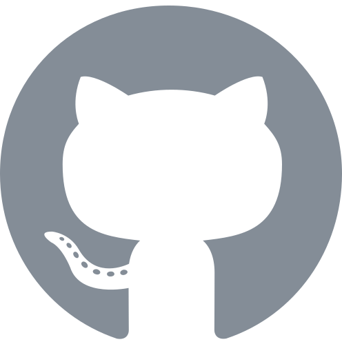

<picture>
  <source media="(prefers-color-scheme: dark)" srcset="assets/banner-dark.svg">
  
</picture>

More than **10+** years of production software. Full-stack by habit, security-minded by training, consultant by current invoice.

**Open to remote roles, full-stack and/or security-focused.** [Write me](mailto:josed.riosc@gmail.com) or [book 20 min](https://cal.com/jorius).

### Now

- **co-founding** [Jericho Digital](https://jericho-digital.com) with [Jhoany Londoño](https://github.com/jlondo97): custom software, SaaS and agentic development with AI.
- **writing** sci-fi stories of my own in the [Dark Galaxy](https://jorius.github.io/darkgalaxy) universe. A couple of drafts, slow but with vision.
- **building** a 2D game set in that same universe.
- **home** a lovely family and 4 naughty cats.

### Built lately

- [ **Liber Linteum**](https://jorius.github.io/liber-linteum/): **Local-only note taker.** Migrate from Notion or open your Obsidian vaults as they are; plain Markdown in folders you own, no cloud, no telemetry.
- [ **None Shall Pass**](https://jorius.github.io/none-shall-pass/): **Mini-game, rogue-like firewall defense.** Real HTTP and SSH requests; spear the malicious ones before they reach the server.
- [ **Engineer Mentat Academy**](https://jorius.github.io/engineer-mentat-academy/): **Interview trainer.** 385 junior-to-senior questions in English and Spanish, code and SQL in the browser.

Everything else lives on [/projects](https://jorius.github.io/projects).

---

[ jorius.github.io](https://jorius.github.io) · [ Email](mailto:josed.riosc@gmail.com) · [ LinkedIn](https://www.linkedin.com/in/jose-rios-c/) · [ WhatsApp](https://wa.me/573013930289) · [ PGP](https://jorius.github.io/pgp)

**PGP Fingerprint** `5C63 48A7 862E 4138 372F 28CC 3656 0282 0FC1 B86C`

```text
-----BEGIN PGP PUBLIC KEY BLOCK-----

mDMEaauFBhYJKwYBBAHaRw8BAQdAzfoX2KFYFcPZ+uHl2wkoRR8kyfjsxVORHlLQ
zO9osOa0Ikpvc2UgUsOtb3MgPGpvc2VkLnJpb3NjQGdtYWlsLmNvbT6IkwQTFgoA
OxYhBFxjSKeGLkE4Ny8ozDZWAoIPwbhsBQJpq4UGAhsDBQsJCAcCAiICBhUKCQgL
AgQWAgMBAh4HAheAAAoJEDZWAoIPwbhsj04A/3hSus1Hvlg9kygTo7w1PyCb3ALI
+f9gB9xT0v7IPMalAQCAgW+dKEStCGHNCv5V1nwJL2CJTT045FqwjjdIOMzDCLg4
BGmrhQYSCisGAQQBl1UBBQEBB0BsN4pgJP6XdfP5/er0lsrYOYePpt/tRiUJ7MWG
dMd1PAMBCAeIeAQYFgoAIBYhBFxjSKeGLkE4Ny8ozDZWAoIPwbhsBQJpq4UGAhsM
AAoJEDZWAoIPwbhsuGUBAMoklUJ1Do11ymPkPom5LwFxV3iF0V0YVdjaFDkPFLVH
AP9aiHB4DuKXE5q5C58xUv4F74A6o+r4RTQJvS9Ur94dCg==
=Z5KG
-----END PGP PUBLIC KEY BLOCK-----
```
